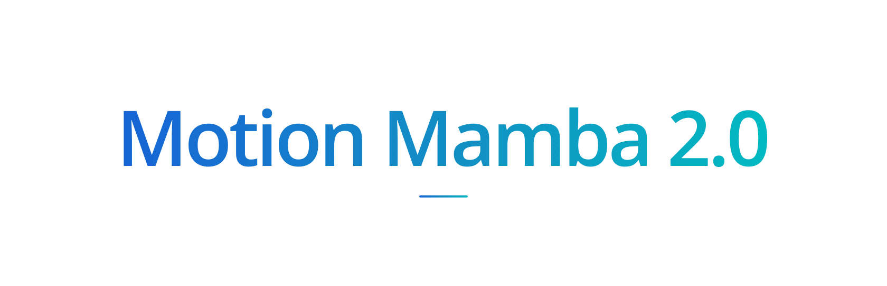

<div align="center">
  
</div>

# Motion Mamba 2.0: Autoregressive Diffusion Mamba for Long-Horizon Humanoid Control

[](https://huggingface.co/papers/2611.29897)

This is the official repository for the paper:

> **Motion Mamba 2.0: Autoregressive Diffusion Mamba for Long-Horizon Humanoid Control**
>
> [Yue Huang](https://github.com/hyue060825-boop)\*, [Tianshan Zhang](https://neptune-t.github.io/)\*, [Zeyu Zhang](https://steve-zeyu-zhang.github.io/)\*<sup>†</sup>, [Jayeon Kang](https://github.com/JayeonKangNature), [Akide Liu](https://scholar.google.com/citations?user=1HjSeKgAAAAJ&hl=en), [Sungjoon Choi](https://scholar.google.com/citations?user=1_PHYMEAAAAJ&hl=en), [Dacheng Tao](https://scholar.google.com/citations?user=RwlJNLcAAAAJ), and [Hao Tang](https://ha0tang.github.io/)<sup>‡</sup>
>
> *Equal contribution. <sup>†</sup>Project lead. <sup>‡</sup>Corresponding author.
>
> ### [Paper](https://arxiv.org/abs/2611.29897) | [Website](https://aigeeksgroup.github.io/MotionMamba2.0/) | [Models](https://huggingface.co/AIGeeksGroup/MotionMamba2.0) | [Data](https://huggingface.co/datasets/AIGeeksGroup/MotionMamba2.0)

---

## 🥳Introduction

Motion Mamba 2.0 generates controllable humanoid motion in a streaming, autoregressive manner. It produces 52-frame motion windows at 25 FPS, conditioned on text, motion history and spatial constraints, including targets beyond the current generation window.

The model combines three components:

- **Root/body diffusion:** two stages generate root motion and articulated body motion.
- **Local attention and recurrent state:** a sliding KV cache retains recent features, while Mamba carries a compressed motion state across windows.
- **Persistent Content Memory (PCM):** state summaries, state changes and text-conditioned features update two content slots per layer, making recurrent information accessible to attention.

<div align="center">
  
</div>

## 📦Data and model resources

Training uses retargeted G1 motion from BONES Seed, HumanML3D and HiPHI. See the [data format and preparation guide](doc/data.md) for the motion representation, JSONL index and cached text features.

Prepare the following resources outside the source directory:


| Resource                                     | Source                                                                                                                                                                                            | Use                                    |
| ---------------------------------------------- | --------------------------------------------------------------------------------------------------------------------------------------------------------------------------------------------------- | ---------------------------------------- |
| Motion Mamba 2.0 weights                     | [Model repository](https://huggingface.co/AIGeeksGroup/MotionMamba2.0)                                                                                                                            | Evaluation and simulation              |
| Retargeted motion data                       | [Dataset repository](https://huggingface.co/datasets/AIGeeksGroup/MotionMamba2.0)                                                                                                                 | Training                               |
| Frozen G1 codec and normalization statistics | [Bundled frontend assets](https://huggingface.co/AIGeeksGroup/MotionMamba2.0/tree/main/frontend)                                                                                                  | Training, evaluation and simulation    |
| G1 skeleton and viewer assets                | Resource sources in `configs/downloads.yaml`                                                                                                                                                      | Training, evaluation and visualization |
| Text encoder and adapter                     | [LLM2Vec MNTP](https://huggingface.co/McGill-NLP/LLM2Vec-Meta-Llama-3-8B-Instruct-mntp), [supervised adapter](https://huggingface.co/McGill-NLP/LLM2Vec-Meta-Llama-3-8B-Instruct-mntp-supervised) | Interactive text prompts               |

The model repository includes `MotionMamba2.pt` and the frozen codec with all three normalization-statistics folders under `frontend/`. The asset downloader saves them to `<asset-root>/motion/MotionMamba2.pt` and `<asset-root>/motion/frontend/`; set `MM2_CHECKPOINT` and `MM2_FRONTEND_DIR` accordingly.

The benchmark inputs and cached text features are included in `benchmarks/benchmark_assets/`. Evaluation uses these cached features; it does not require the text encoder. Downloading Llama-based resources requires the corresponding upstream access and license agreement.

## ⚙️Environment setup

Use Python 3.11 on Linux with an NVIDIA CUDA GPU. Install a PyTorch build compatible with your CUDA driver, then install the project:

```bash
python3.11 -m venv .venv
source .venv/bin/activate
python -m pip install --upgrade pip setuptools wheel
python -m pip install torch
python -m pip install --no-deps triton==3.5.1
python -m pip install -e .
```

Python dependencies are listed in `pyproject.toml`. Simulation requires additional Python packages, Node.js/npm, tmux, TensorRT, ONNX Runtime and a separately installed SONIC physics/policy stack; installation commands are provided in the simulation section. Environments, compiled binaries, datasets and model weights are supplied separately.

## 🔥 Training

Prepare the retargeted G1 motions, JSONL index and cached text features using the [data guide](doc/data.md). Set the codec and skeleton paths in `configs/paths.env`, then set `data.index_path`, `data.feature_root`, `data.text_features_paths` and `output_path` in `configs/training_motion_mamba2.yaml`.

Both architectures train the root and body denoisers from scratch on the same 52-frame continuation task. When a sample includes history, a differentiable pass encodes its clean ground-truth prefix. Only the continuation receives diffusion noise. Both models use the frozen FP32 codec, a global batch of 512 and 100,000 updates. The objective gives equal weight to hybrid Smooth L1, decoded-body L1, visible-control L1 and forward-kinematics consistency.

```bash
python -m scripts.training_motion_mamba2 --help
python -m scripts.training_motion_mamba2 --mamba_transformer_pcm
```

`--mamba_transformer_pcm` selects the full Motion Mamba 2.0 model (the default). Each layer combines local attention with recurrent Mamba state and two writable PCM slots. The completed run exports `MotionMamba2.pt` under `output_path`.

### 🪟 Minimal attention baseline

Minimal uses softmax attention in both denoisers. Each motion token can attend to the current window, the four most recently committed chunks and four learned attention sinks per layer. The oldest chunk drops out when the window fills. The sinks stay visible throughout the rollout. This gives an attention-only reference for measuring what Mamba state and PCM add to long-horizon motion. [Attention](motion_mamba2/model/attention.py) · [KV cache](motion_mamba2/model/kv_cache.py)

Train Minimal with the same data and training configuration. Its checkpoints are saved under `<output_path>/minimal_baseline/`.

```bash
python -m scripts.training_motion_mamba2 --minimal_baseline
```

To try a four-window rollout, point `MM2_CHECKPOINT` at the exported baseline weights and set `MM2_OUTPUT_PATH` to your benchmark output directory. During denoising, all guidance passes read the same history. The sampler commits each accepted window once before generating the next 52 frames.

```bash
export MM2_CHECKPOINT=/path/to/training-output/minimal_baseline/MinimalBaseline.pt
export MM2_OUTPUT_PATH=/path/to/evaluation-output
python -m scripts.evaluate --minimal_baseline --domain humanml3d --task frames_208 --limit 1
```

This example generates 208 frames for one HumanML3D case with each of its three benchmark seeds. The trajectories and scores are written under `$MM2_OUTPUT_PATH/minimal_baseline/humanml3d/frames_208/`. To evaluate the full model on the same case, point `MM2_CHECKPOINT` at `MotionMamba2.pt` and use `--mamba_transformer_pcm`.

## 📊 Evaluation

Evaluate Motion Mamba 2.0 on BONES Seed, HumanML3D and HiPHI using the included benchmark assets. Set the model/frontend paths and `MM2_OUTPUT_PATH` in your path configuration, then run:

```bash
python -m scripts.evaluate --help
python -m scripts.evaluate --check
python -m scripts.evaluate --domain all
```

Run a selected domain or rescore existing outputs:

```bash
python -m scripts.evaluate --domain humanml3d --task frames_208
python -m scripts.evaluate --domain bones --task frames_208
python -m scripts.evaluate --domain hiphi --task frames_988
python -m scripts.evaluate --score-only --domain all
```

BONES and HumanML3D use 52- and 208-frame rollouts. HiPHI uses 52, 208, 468 and 988 frames. Each condition evaluates 128 fixed source families with three noise seeds, using ten deterministic DDIM steps and text/spatial guidance scales `(2,2)`. Protocol settings and input fingerprints are stored in `configs/benchmarks.yaml` and `configs/benchmark_assets.json`.

## 🤖Visualization and simulation

The interactive demo connects the text encoder, PCM-enabled motion generator, custom Viser interface and web bridge to an external SONIC physics/policy stack. Prepare the [SONIC checkout](https://github.com/NVlabs/GR00T-WholeBodyControl) at the source revision specified by `sonic_source_revision` in `configs/downloads.yaml`. Apply the integration below, then build the deployment components and install their dependencies using the SONIC instructions.

Install the additional packages and web dependencies:

```bash
python -m pip install -e '.[simulation]'
python -m pip install -r configs/requirements_simulation.txt
# Run in the environment used for the physics service:
python -m pip install -r configs/requirements_physics.txt
npm ci --prefix visualization/web
```

Download the external assets and prepare the SONIC integration:

```bash
python visualization/download_assets.py \
  --root /path/to/assets --sonic-root /path/to/SONIC
python visualization/prepare_sonic.py --source /path/to/SONIC
# Apply the integration after reviewing the preview:
python visualization/prepare_sonic.py --source /path/to/SONIC --apply
```

Set model, frontend, text encoder, viewer, Python interpreter, SONIC, TensorRT and ONNX Runtime paths in `configs/paths.local.env` and reload it as shown above. Select available GPUs and ports in `configs/simulation.env`, then run:

```bash
python -m scripts.simulation check
python -m scripts.simulation plan
python -m scripts.simulation start
python -m scripts.simulation status
python -m scripts.simulation stop
```

With the default ports, open Viser at `http://127.0.0.1:2333` and SONIC at `http://127.0.0.1:8080`. Mouse waypoint control is enabled on connection; click the floor to place a target, and press `P` to toggle this mode.

Inference retains three distinct CFG conditions. When the CUDA Graph contract is satisfied, their forwards are captured serially within separate root/body stack-level graphs. PCM reads and accepted-state commits remain outside the read-only graphs.

## 🫶Acknowledgements

We thank the authors of NVIDIA ARDY, Mamba and SONIC, together with the BONES Seed, HumanML3D and HiPHI dataset providers, for their research and open-source resources.
